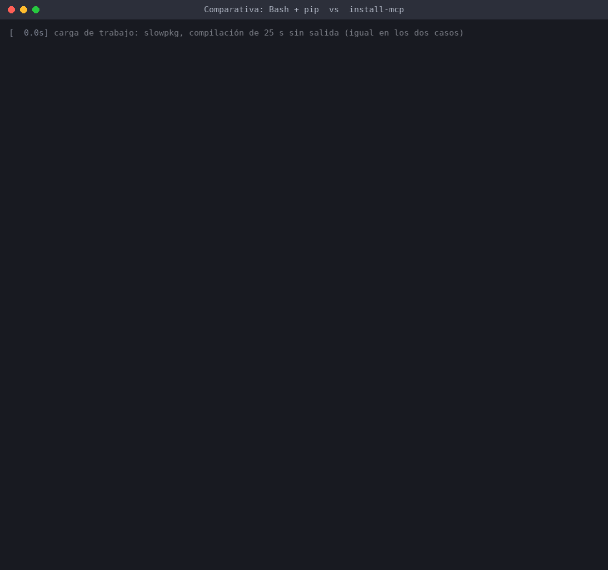
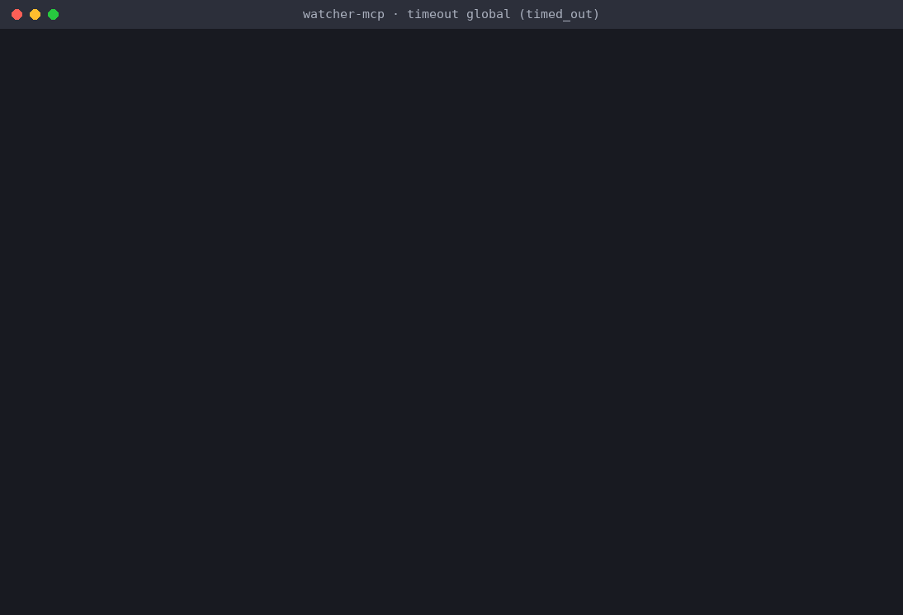
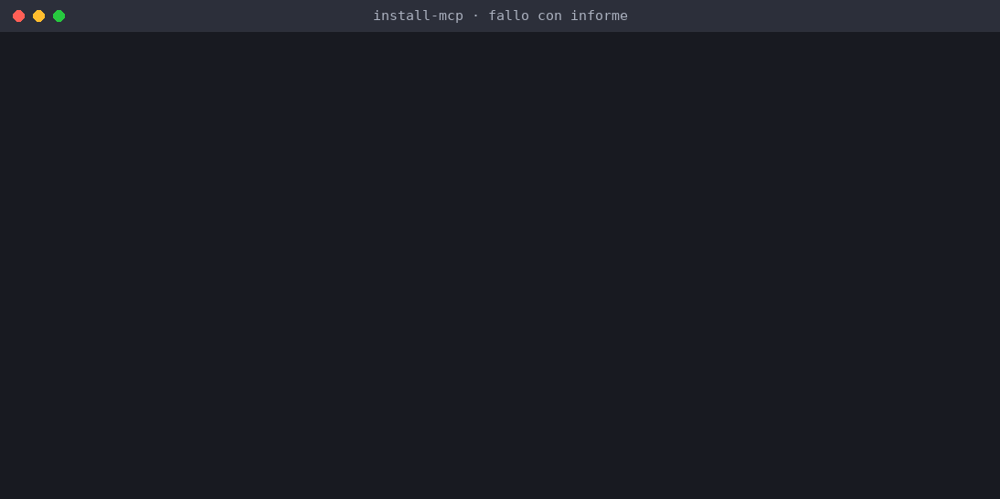
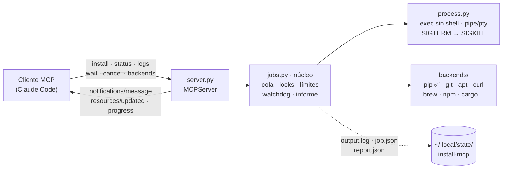

# install-mcp

[](https://github.com/Eliaxs1900/install-mcp/actions/workflows/tests.yml)


[](LICENSE)

Servidor MCP que ejecuta instalaciones **como jobs en segundo plano**. Devuelve un
`job_id` al instante y guarda la salida línea a línea, sin buffering. Avisa por
notificación MCP si el proceso se queda sin salida (`stalled`) y cuando termina, con
un informe: éxito o fallo, código de salida, duración, versiones instaladas y líneas
relevantes del log. **Ninguna espera es infinita**: `wait` tiene un tope duro y cada
job tiene un timeout global (`timed_out`).

> **English:** an MCP server that runs installs (pip/uv today; git, apt, curl, brew… by
> design) as background jobs. It returns a job id immediately and streams unbuffered
> logs. A watchdog flags stalled processes, every wait is bounded, and an MCP
> notification carries a report when the job ends.



## Por qué: la comparativa

Los agentes como Claude Code instalan con `Bash` + `pip install`. Si la instalación
tarda más que el límite de la herramienta (120 s), el agente se queda bloqueado. Luego
el comando pasa a segundo plano y el agente solo tiene un fichero de salida que debe
releer de vez en cuando. Ese fichero no le dice si el proceso sigue vivo o colgado,
ni cuándo terminó.

[`examples/compare.py`](examples/compare.py) hace las dos cosas con **el mismo paquete**:
`slowpkg`, un sdist local que tarda 25 s en compilar sin escribir nada, como cualquier
wheel que se compila desde el código fuente. Todas las cifras se miden en la propia
ejecución. Esta tabla sale de la grabación del GIF de arriba, hecha en un contenedor
Docker:

| | ANTES · Bash + pip | DESPUÉS · install-mcp |
|---|---|---|
| El agente recupera el control | a los 8 s (límite de Bash a escala; 120 s reales) | **0,04 s** |
| Durante la compilación ve… | el log congelado en `Building wheel … started` | estado, pid, comando, segundos sin salida |
| Aviso de atasco | ninguno | **`stalled` a los 7 s** con pid, comando y últimas líneas |
| Se entera de que terminó | por sondeo, 2,5 s tarde (y solo si sigue sondeando) | notificación al instante |
| Llamadas del agente | 1 Bash + 5 sondeos (`tail`) | 2 (`install` + `wait`) |
| Informe final | texto en bruto | exit code, versión instalada (`slowpkg 1.0`), duración, pasos |

Con pip, el log no llega a estar vacío: pip escribe unas líneas y luego se calla
mientras compila. Con programas que acumulan stdout en un buffer (herramientas en C,
scripts de Python sin `-u`), el fichero sí queda **vacío** hasta el final.
install-mcp lo resuelve con `io_mode = "pty"`. El test
[`test_buffered_program_pipe_vs_pty`](tests/test_limits.py) lo demuestra: por tubería,
0 líneas mientras el programa trabaja; con pty, en vivo.

## Demos

Todas son ejecuciones reales del servidor por stdio (como lo lanza Claude Code),
grabadas en un contenedor Docker con [`scripts/make_demos.sh`](scripts/make_demos.sh).
Las rutas del usuario se acortan a `~`. En el GIF, las pausas largas se acortan; los
tiempos `[ 12.3s]` impresos son los reales. Cada demo tiene también su grabación
`.cast` ([asciinema](https://asciinema.org)) y una captura PNG completa.

### Atasco detectado y recuperado (`stalled`)

La compilación pasa 18 s sin escribir nada. A los 4 s llega el aviso `stalled` con el
pid, el comando y las últimas líneas. Cuando pip vuelve a escribir, el servidor avisa
de que se reanuda la salida y, al acabar, envía el informe.


### Timeout global (`timed_out`)

Una compilación que no acabaría nunca, con `job_timeout_s: 12`. El servidor envía
SIGTERM al grupo de procesos y, si hace falta, SIGKILL. El aviso llega como `error`, y
la demo comprueba al final que el proceso ya no existe.



### Instalación real desde PyPI (uv)


### Fallo con informe

Un paquete que no existe: el informe trae el código de salida y las líneas de error
relevantes, sin tener que leer el log entero.



Capturas completas: [compare](docs/demos/compare.png) ·
[stall](docs/demos/stall.png) · [timeout](docs/demos/timeout.png) ·
[install](docs/demos/install.png) · [fail](docs/demos/fail.png)

### Usado desde Claude Code

Registrado con `claude mcp add` (ver más abajo), Claude Code ve las tools
`mcp__install-mcp__*`. Esta es una ejecución real desde una sesión de Claude Code
(solo se acortan las rutas):

```text
→ install(backend="pip", params={"packages": ["pypdf"], "venv": "claude-code-demo"})
← {"job_id": "718a09b210da", "state": "queued",
   "summary": "pip install pypdf en ~/.local/state/install-mcp/venvs/claude-code-demo (vía uv)",
   "next": "wait('718a09b210da', timeout_s=60) o logs('718a09b210da', tail=30). …"}

→ wait(job_id="718a09b210da", timeout_s=60)
← {"done": true, "report": {
     "headline": "[718a09b210da] OK en 0.6s – pip install pypdf en ~/.local/state/install-mcp/venvs/claude-code-demo (vía uv) (pypdf 7.1.1, (python) 3.15.2)",
     "state": "succeeded", "exit_code": 0, "duration_s": 0.645,
     "steps": [{"name": "create-venv", "state": "ok", "exit_code": 0, "duration_s": 0.343, …},
               {"name": "install", "state": "ok", "exit_code": 0, "duration_s": 0.262,
                "command": ["uv", "pip", "install", "--no-progress", "--python", "…/bin/python", "--", "pypdf"]}],
     "installed": {"pypdf": "7.1.1", "(python)": "3.15.2"},
     "limits": {"job_timeout_s": 3600, "stall_timeout_s": 600, "io_mode": "pipe"},
     "info": {"venv": "~/.local/state/install-mcp/venvs/claude-code-demo", "installer": "uv", …}}}
```

## Cómo funciona



- **Backends como planificadores puros**: un backend solo valida parámetros y devuelve
  un `Plan` con argv explícitos. El núcleo ejecuta, registra, limita y notifica. Por
  eso añadir git, apt o curl no necesita tocar la cola, los logs ni la seguridad.
- **Estados**: `queued` → `running` ⇄ `stalled` → `succeeded` | `failed` | `cancelled` | `timed_out`.
- **Seguridad**:
  - nada de `shell=True`;
  - se rechazan los valores que empiezan por `-`;
  - allowlist de backends;
  - sin `sudo` salvo opt-in (y entonces `sudo -n`);
  - rutas limitadas a raíces permitidas;
  - solo HTTPS;
  - redacción de tokens y contraseñas en logs, argv e informes.

Diseño completo en [docs/design.md](docs/design.md).

## Instalación

Requiere Python 3.11+.

```bash
git clone https://github.com/Eliaxs1900/install-mcp.git
cd install-mcp
uv venv --python 3.12 .venv
uv pip install --python .venv/bin/python -e .
```

Sin uv: `python3 -m venv .venv && .venv/bin/pip install -e .`

## Registrarlo en Claude Code

Desde la carpeta del proyecto, para todos tus proyectos:

```bash
claude mcp add --scope user install-mcp -- "$PWD/.venv/bin/install-mcp"
```

O solo para un proyecto, con un `.mcp.json` en su raíz:

```json
{
  "mcpServers": {
    "install-mcp": {
      "command": "/RUTA/ABSOLUTA/install-mcp/.venv/bin/install-mcp",
      "args": ["--config", "/RUTA/ABSOLUTA/config.toml"]
    }
  }
}
```

`args` es opcional; sin `--config` se usa `~/.config/install-mcp/config.toml` si existe.
Comprueba que conecta con `claude mcp list`.

## Tools

| Tool | Para qué |
|---|---|
| `backends()` | Qué instaladores hay, si están permitidos, sus límites y el esquema de sus `params`. |
| `install(backend, params, wait_s=0)` | Lanza el job y devuelve `job_id` al instante. |
| `status(job_id, tail=10)` | Estado, paso actual, pid, comando, segundos sin salida, código de salida, duración, límites, informe. |
| `list_jobs(state?, limit=20)` | Jobs recientes. |
| `logs(job_id, tail=50, since_seq?, stream=all)` | Últimas líneas; con `since_seq`, solo las nuevas. |
| `wait(job_id, timeout_s?)` | Espera acotada (60 s por defecto, tope duro 300 s): el informe, o "sigue en curso" con pid y últimas líneas. Emite `notifications/progress`. |
| `cancel(job_id)` | Cancela (SIGTERM y luego SIGKILL al grupo de procesos). |

Recursos: `job://<id>` (estado + informe) y `jobs://list`. Los avisos van a quien lanzó
el job (`notifications/message`, con el informe en `data.report`) y a quien esté
suscrito a `job://<id>` (`notifications/resources/updated`).

### Límites

| Qué | Por defecto | Al vencer |
|---|---|---|
| `wait` | 60 s (`default_wait_s`), tope duro 300 s (`max_wait_s`) | `done: false` + estado, pid, `silent_for_s`, últimas líneas |
| Tiempo en cola | 3600 s (`max_queue_s`) | `timed_out` |
| Duración del job | 3600 s (`default_job_timeout_s`) | SIGTERM al grupo, 5 s, SIGKILL; `timed_out` |
| Sin salida | 300 s (`default_stall_timeout_s`; pip 600 s) | `stalled` + aviso con pid, comando y últimas líneas (no mata el proceso) |

Se fijan por petición (pip: `job_timeout_s`, `stall_timeout_s`), por backend en la
configuración (`[backends.pip] job_timeout_s = 1800`) o globalmente.

### Parámetros del backend `pip`

| Param | Ejemplo | Notas |
|---|---|---|
| `packages` | `["pypdf", "requests>=2.32"]` | PEP 508 sin URLs; nada que empiece por `-`. |
| `requirements` | `"/abs/requirements.txt"` | Alternativa o complemento a `packages`. |
| `venv` | `"tools"` o `"/abs/ruta/.venv"` | Un nombre crea `<state_dir>/venvs/<nombre>`; una ruta debe estar dentro de `allowed_roots`. |
| `python` | `"3.12"` o `"/abs/python3"` | Versión con uv (o `python3.12` en PATH). |
| `installer` | `"auto"` / `"uv"` / `"pip"` | `auto` = uv si está. |
| `upgrade`, `pre` | `true` | |
| `index_url`, `extra_index_urls` | `"https://…/simple"` | Solo https; credenciales redactadas. |
| `find_links`, `no_index` | `["/abs/wheels"]`, `true` | Instalación offline. |
| `job_timeout_s` | `1800` | Al vencer: `timed_out` (0 = sin límite). |
| `stall_timeout_s` | `120` | Sin salida N s → `stalled` (0 = sin watchdog). |

## Configuración

Ver [examples/config.example.toml](examples/config.example.toml):

- `allowed_backends`: la allowlist (por defecto solo `pip`).
- `allow_privileged`: `false` por defecto.
- `allowed_roots`: dónde pueden escribir los backends.
- Límites: `max_parallel`, `default_wait_s`, `max_wait_s`, `max_queue_s`,
  `default_job_timeout_s`, `default_stall_timeout_s`, `default_io_mode`.
- `[backends.<nombre>]`: límites e `io_mode` propios de un backend.
- `plugins`: backends externos, como `"paquete.modulo:Clase"`.

`INSTALL_MCP_STATE_DIR` cambia el directorio de estado (por defecto
`~/.local/state/install-mcp`).

## Tests y demos en Docker (sin ensuciar tu máquina)

```bash
docker build --target test -t install-mcp:test .
docker run --rm install-mcp:test
```

Son 52 tests: jobs en paralelo, logs en vivo, cancelación, `stalled`, `timed_out`,
`wait` acotado, pipe frente a pty, notificaciones de punta a punta por MCP,
redacción de secretos e instalaciones reales offline con pip y con uv.

Para regenerar las demos (graban en un pty dentro del contenedor y renderizan GIF/PNG):

```bash
docker build --target demo -t install-mcp:demo .
docker run --name imcp-demos install-mcp:demo
docker cp imcp-demos:/out/. docs/demos/
docker rm imcp-demos
```

Sin Docker: `uv pip install -e ".[dev]"` y `.venv/bin/python -m pytest -q`. Las demos
también se pueden ejecutar directamente: `python examples/demo.py stall`,
`python examples/compare.py`.

## Estructura

```
src/install_mcp/
  server.py              tools y recursos MCP, espera acotada con progreso
  jobs.py                núcleo: jobs, cola, límites, watchdog, logs, informe
  process.py             exec sin shell, lectura en vivo (pipe/pty/stdbuf), terminación acotada
  notify.py              eventos -> notifications/message, resources/updated, subscriptions/listen
  security.py            redacción, https, checksums, raíces permitidas
  config.py              configuración
  backends/base.py       interfaz Backend / Plan / CommandStep / FuncStep
  backends/pip.py        backend pip/uv
  backends/_template.py  plantilla (git) para nuevos backends
docs/design.md           diseño
docs/demos/              GIF, PNG y .cast de las demos
examples/                demos, comparativa, slowpkg, cliente mínimo y configuración
scripts/                 grabación (pty -> .cast) y render (.cast -> GIF/PNG)
tests/                   pytest
```

## Limitaciones

- Solo está implementado el backend `pip`. El resto está diseñado
  ([docs/design.md §7](docs/design.md)), con una plantilla para `git`.
- Funciona en macOS y Linux (también WSL). En Windows nativo faltaría la cancelación
  por grupo de procesos.
- Los jobs en curso no sobreviven a un reinicio del servidor: se marcan como interrumpidos.
- Usa el SDK `mcp` 2.x (`MCPServer`, el sucesor de FastMCP).

## Licencia

[MIT](LICENSE)
