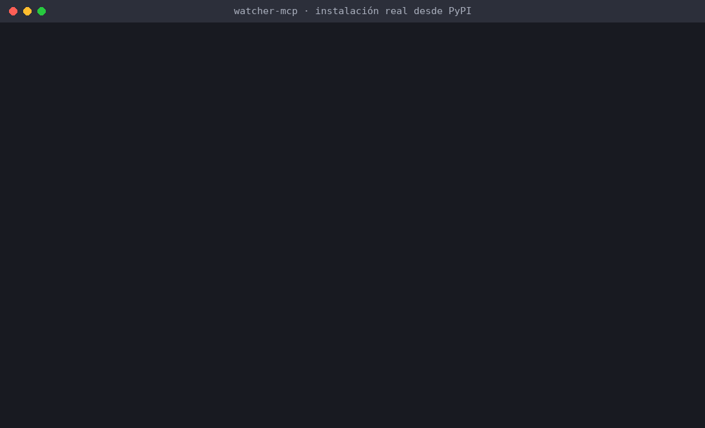
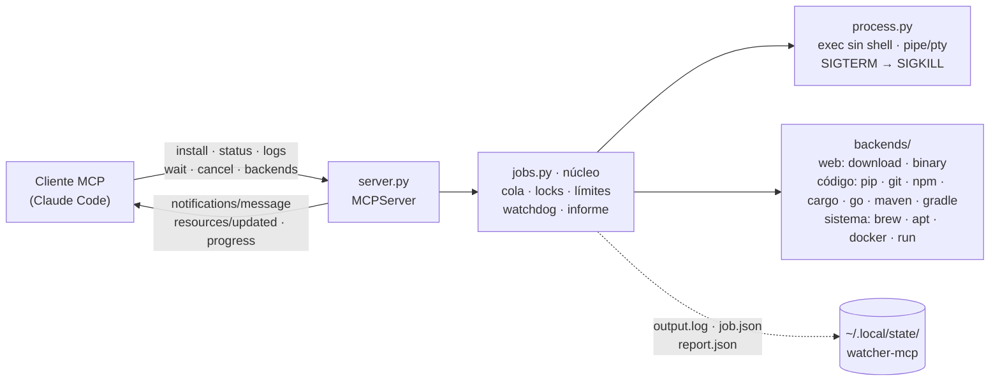

# watcher-mcp

[](https://github.com/Eliaxs1900/watcher-mcp/actions/workflows/tests.yml)


[](LICENSE)

Servidor MCP que **lanza y vigila trabajos largos**: instalaciones, descargas, clones,
builds y tests. Cada trabajo corre en segundo plano y la llamada devuelve un `job_id` al
instante. La salida se guarda línea a línea, sin buffering. Un vigilante avisa por
notificación MCP si el proceso se queda en silencio (`stalled`) y cuando termina, con un
informe: éxito o fallo, código de salida, duración, versiones instaladas y líneas
relevantes del log. **Ninguna espera es infinita**: `wait` tiene un tope duro y cada
trabajo tiene un tiempo máximo (`timed_out`).

> **English:** an MCP server that launches and watches long-running jobs (pip/uv, git,
> https downloads and binaries, npm, cargo, go, maven, gradle, brew, apt, docker pull,
> allowlisted build/test commands). It returns a job id immediately and streams unbuffered
> logs. A watchdog flags stalled processes, every wait is bounded, and an MCP
> notification carries a report when the job ends.


## Por qué: la comparativa

Los agentes como Claude Code instalan con `Bash` + `pip install`. Si la instalación
tarda más que el límite de la herramienta (120 s), el agente se queda bloqueado. Luego
el comando pasa a segundo plano y el agente solo tiene un fichero de salida que debe
releer de vez en cuando. Ese fichero no le dice si el proceso sigue vivo o colgado,
ni cuándo terminó.

[`examples/compare.py`](examples/compare.py) hace las dos cosas con **el mismo paquete**:
`slowpkg`, un sdist local que tarda 25 s en compilar sin escribir nada, como cualquier
wheel que se compila desde el código fuente. Todas las cifras se miden en la propia
ejecución. Esta tabla sale de la grabación del GIF de arriba, hecha en un contenedor
Docker:

| | ANTES · Bash + pip | DESPUÉS · watcher-mcp |
|---|---|---|
| El agente recupera el control | a los 8 s (límite de Bash a escala; 120 s reales) | **0,04 s** |
| Durante la compilación ve… | el log congelado en `Building wheel … started` | estado, pid, comando, segundos sin salida |
| Aviso de atasco | ninguno | **`stalled` a los 7 s** con pid, comando y últimas líneas |
| Se entera de que terminó | por sondeo, 2,5 s tarde (y solo si sigue sondeando) | notificación al instante |
| Llamadas del agente | 1 Bash + 5 sondeos (`tail`) | 2 (`install` + `wait`) |
| Informe final | texto en bruto | exit code, versión instalada (`slowpkg 1.0`), duración, pasos |

Con pip, el log no llega a estar vacío: pip escribe unas líneas y luego se calla
mientras compila. Con programas que acumulan stdout en un buffer (herramientas en C,
scripts de Python sin `-u`), el fichero sí queda **vacío** hasta el final.
watcher-mcp lo resuelve con `io_mode = "pty"`. El test
[`test_buffered_program_pipe_vs_pty`](tests/test_limits.py) lo demuestra: por tubería,
0 líneas mientras el programa trabaja; con pty, en vivo.

## Demos

Todas son ejecuciones reales del servidor por stdio (como lo lanza Claude Code),
grabadas en un contenedor Docker con [`scripts/make_demos.sh`](scripts/make_demos.sh).
Las rutas del usuario se acortan a `~`. En el GIF, las pausas largas se acortan; los
tiempos `[ 12.3s]` impresos son los reales. Cada demo tiene también su grabación
`.cast` ([asciinema](https://asciinema.org)) y una captura PNG completa.

### Atasco detectado y recuperado (`stalled`)

La compilación pasa 18 s sin escribir nada. A los 4 s llega el aviso `stalled` con el
pid, el comando y las últimas líneas. Cuando pip vuelve a escribir, el servidor avisa
de que se reanuda la salida y, al acabar, envía el informe.


### Timeout global (`timed_out`)

Una compilación que no acabaría nunca, con `job_timeout_s: 12`. El servidor envía
SIGTERM al grupo de procesos y, si hace falta, SIGKILL. El aviso llega como `error`, y
la demo comprueba al final que el proceso ya no existe.


### Instalación real desde PyPI (uv)



### Fallo con informe

Un paquete que no existe: el informe trae el código de salida y las líneas de error
relevantes, sin tener que leer el log entero.


Capturas completas: [compare](docs/demos/compare.png) ·
[stall](docs/demos/stall.png) · [timeout](docs/demos/timeout.png) ·
[install](docs/demos/install.png) · [fail](docs/demos/fail.png)

### Usado desde Claude Code

Registrado con `claude mcp add` (ver más abajo), Claude Code ve las tools
`mcp__watcher-mcp__*`. Esta es una ejecución real desde una sesión de Claude Code
(solo se acortan las rutas):

```text
→ install(backend="pip", params={"packages": ["pypdf"], "venv": "claude-code-demo"})
← {"job_id": "718a09b210da", "state": "queued",
   "summary": "pip install pypdf en ~/.local/state/watcher-mcp/venvs/claude-code-demo (vía uv)",
   "next": "wait('718a09b210da', timeout_s=60) o logs('718a09b210da', tail=30). …"}

→ wait(job_id="718a09b210da", timeout_s=60)
← {"done": true, "report": {
     "headline": "[718a09b210da] OK en 0.6s – pip install pypdf en ~/.local/state/watcher-mcp/venvs/claude-code-demo (vía uv) (pypdf 7.1.1, (python) 3.15.2)",
     "state": "succeeded", "exit_code": 0, "duration_s": 0.645,
     "steps": [{"name": "create-venv", "state": "ok", "exit_code": 0, "duration_s": 0.343, …},
               {"name": "install", "state": "ok", "exit_code": 0, "duration_s": 0.262,
                "command": ["uv", "pip", "install", "--no-progress", "--python", "…/bin/python", "--", "pypdf"]}],
     "installed": {"pypdf": "7.1.1", "(python)": "3.15.2"},
     "limits": {"job_timeout_s": 3600, "stall_timeout_s": 600, "io_mode": "pipe"},
     "info": {"venv": "~/.local/state/watcher-mcp/venvs/claude-code-demo", "installer": "uv", …}}}
```

## Cómo funciona



- **Backends como planificadores puros**: un backend solo valida parámetros y devuelve
  un `Plan` con argv explícitos. El núcleo ejecuta, registra, limita y notifica. Por
  eso añadir git, apt o curl no necesita tocar la cola, los logs ni la seguridad.
- **Estados**: `queued` → `running` ⇄ `stalled` → `succeeded` | `failed` | `cancelled` | `timed_out`.
- **Seguridad**:
  - nada de `shell=True`;
  - se rechazan los valores que empiezan por `-`;
  - allowlist de backends;
  - sin `sudo` salvo opt-in (y entonces `sudo -n`);
  - rutas limitadas a raíces permitidas y, dentro de ellas, **zonas protegidas**: nada con un
    componente oculto (`~/.zshrc`, `~/.ssh`, `proyecto/.git/hooks`…) ni las subrutas sensibles de
    `~/Library` (`LaunchAgents`, `Preferences`, `Keychains`, `Cookies`, `Containers`…), para que una
    instrucción inyectada al cliente no pueda escribir ni leer ahí. El resto de `~/Library` (p. ej. las
    carpetas de sesión de Claude Desktop en `~/Library/Application Support/Claude`) se puede usar. Una
    zona protegida se permite a propósito añadiéndola como raíz explícita: el error dice dónde y da la
    línea exacta;
  - las descargas no sobrescriben nada salvo `overwrite: true`; la extracción tiene límites de
    tamaño y de número de ficheros;
  - `git` neutraliza la configuración local del repo (hooks, fsmonitor, credential helpers) y no
    actualiza repos que no clonó salvo `trust_existing: true`;
  - `npm` sin scripts de instalación por defecto; `run` con allowlist de programas o reglas por
    prefijo de argumentos y carpeta, y lista de variables de entorno permitidas; los secretos se
    heredan por nombre (`inherit_env`/`env_from`) y su valor se redacta;
  - solo HTTPS;
  - redacción de tokens y contraseñas en logs, argv, informes y parámetros guardados.
- **Varias sesiones a la vez**: cada sesión de Claude Code arranca su propio servidor y todos
  comparten `state_dir`. Cada servidor se identifica con un `flock`: los jobs en curso de otra
  sesión se ven en solo lectura (no se marcan, cancelan ni borran), y los de un servidor que murió
  de golpe se recogen al arrancar el siguiente (se termina su grupo de procesos tras comprobar que
  el pid sigue siendo el mismo programa). En Linux, además, el hijo muere con el servidor.

Diseño completo en [docs/design.md](docs/design.md).

## Instalación

Requiere Python 3.11+.

```bash
git clone https://github.com/Eliaxs1900/watcher-mcp.git
cd watcher-mcp
uv venv --python 3.12 .venv
uv pip install --python .venv/bin/python -e .
```

Sin uv: `python3 -m venv .venv && .venv/bin/pip install -e .`

## Registrarlo en Claude Code

Desde la carpeta del proyecto, para todos tus proyectos:

```bash
claude mcp add --scope user watcher-mcp -- "$PWD/.venv/bin/watcher-mcp"
```

O solo para un proyecto, con un `.mcp.json` en su raíz:

```json
{
  "mcpServers": {
    "watcher-mcp": {
      "command": "/RUTA/ABSOLUTA/watcher-mcp/.venv/bin/watcher-mcp",
      "args": ["--config", "/RUTA/ABSOLUTA/config.toml"]
    }
  }
}
```

`args` es opcional; sin `--config` se usa `~/.config/watcher-mcp/config.toml` si existe.
Comprueba que conecta con `claude mcp list`.

## Tools

| Tool | Para qué |
|---|---|
| `backends()` | Qué instaladores hay, si están permitidos, sus límites y el esquema de sus `params`. |
| `install(backend, params, wait_s=0)` | Lanza el job y devuelve `job_id` al instante. |
| `status(job_id, tail=10)` | Estado, paso actual, pid, comando, segundos sin salida, código de salida, duración, límites, informe. |
| `list_jobs(state?, limit=20)` | Jobs recientes. |
| `logs(job_id, tail=50, since_seq?, stream=all)` | Últimas líneas; con `since_seq`, solo las nuevas. |
| `wait(job_id, timeout_s?)` | Espera acotada (60 s por defecto, tope duro 300 s): el informe, o "sigue en curso" con pid y últimas líneas. Emite `notifications/progress`. |
| `cancel(job_id)` | Cancela (SIGTERM y luego SIGKILL al grupo de procesos). |

Recursos: `job://<id>` (estado + informe) y `jobs://list`. Los avisos van a quien lanzó
el job (`notifications/message`, con el informe en `data.report`) y a quien esté
suscrito a `job://<id>` (`notifications/resources/updated`).

### Backends

Cubren los focos de interacción habituales de un agente de código. Todos aceptan además
`job_timeout_s` y `stall_timeout_s`. `backends()` devuelve el esquema completo de cada uno.

| Foco | Backend | Para qué | Ejemplo de `params` |
|---|---|---|---|
| Web | `download` | Fichero por HTTPS, checksum opcional, extracción segura de tar/zip | `{"url": "https://…/fw.tar.gz", "dest": "~/fw", "extract": true, "checksum": "sha256:…"}` |
| Web | `binary` | Ejecutable suelto (checksum **obligatorio**), también dentro de un tar/zip | `{"url": "https://…/jq-linux-arm64", "checksum": "sha256:…", "name": "jq"}` |
| Código | `pip` | Paquetes Python en un venv aislado (uv si está) | `{"packages": ["pypdf"], "venv": "tools"}` |
| Código | `git` | Clonar/actualizar (https, ssh, local) sin prompts de credenciales | `{"url": "git@github.com:org/repo.git", "dest": "/abs/repo", "depth": 1}` |
| Código | `npm` | Paquetes en un prefijo aislado, o dependencias de un proyecto (npm ci/pnpm/yarn) | `{"project_dir": "/abs/web"}` |
| Código | `cargo` | `cargo install` en una raíz aislada | `{"crates": ["ripgrep@14.1.1"]}` |
| Código | `go` | `go install ruta@versión` en un GOBIN aislado | `{"packages": ["golang.org/x/tools/gopls@latest"]}` |
| Código | `maven` | Artefactos a `~/.m2`, o objetivos de un proyecto (allowlist) con `mvnw` si existe | `{"project_dir": "/abs/app", "goals": ["package"], "skip_tests": true}` |
| Código | `gradle` | Tareas de un proyecto (allowlist) con `gradlew` si existe | `{"project_dir": "/abs/app", "tasks": ["build"]}` |
| Sistema | `brew` | Fórmulas y casks sin auto-update ni prompts | `{"formulae": ["binwalk", "p7zip"]}` |
| Sistema | `apt` | apt-get (Debian/Ubuntu/WSL). **Privilegiado**: requiere `allow_privileged = true` | `{"packages": ["binwalk", "squashfs-tools"]}` |
| Sistema | `docker` | `docker pull` de imágenes | `{"images": ["python:3.12-slim"]}` |
| Comandos | `run` | Builds, tests y scripts largos con un programa de una allowlist o una regla `commands`. **Desactivado** por defecto | `{"program": "mvn", "args": ["-B", "verify"], "cwd": "/abs/app"}` |

Por defecto están permitidos todos menos `apt` y `run`. `backends()` dice cómo activar uno que no
lo está: en `how_to_enable` da la ruta del `config.toml` activo (`config_file`, y si existe) y el
fragmento TOML exacto para pegar (`toml`). Si `run` está permitido pero sin programas ni reglas,
también lo da. A mano:

```toml
allowed_backends = ["pip", "git", "download", "binary", "npm", "cargo", "go", "maven", "gradle",
                    "brew", "docker", "apt", "run"]
allow_privileged = true                  # solo si quieres apt (usa `sudo -n`: nunca pide contraseña)

[backends.run]
programs = ["mvn", "pytest", "make"]     # con cualquier argumento, en cualquier cwd permitido
# Reglas más estrechas: programa + prefijo de argumentos + carpeta de trabajo.
commands = [
  { program = "uv", args_prefix = ["run", "python", "tools/"], cwd_under = "~/Desktop/layout-mcp",
    inherit_env = ["GEMINI_API_KEY"] },
]
```

#### Reglas de `run`

Una petición se acepta si `program` está en `programs` **o** casa con alguna regla de `commands`:

- `program`: el mismo nombre (en PATH).
- `args_prefix`: los primeros argumentos deben ser exactamente esos; un elemento que acaba en `/`
  casa con cualquier argumento que empiece así y no tenga `..` (`"tools/"` admite
  `tools/gemini_compare.py`, no `tools/../x.py`). Lo que va después del prefijo es libre.
- `cwd_under`: el `cwd` (resuelto) debe ser esa carpeta o estar dentro. Sigue valiendo además
  `allowed_roots`.
- `inherit_env` (opcional): variables que se copian por nombre solo para esa regla.

Si nada casa, el error dice por qué falló cada regla, p. ej.
`commands[0] = uv run python tools/ (cwd bajo /Users/yo/Desktop/layout-mcp): args[2] = 'evil.py' no está bajo 'tools/'`.

#### Variables de entorno por nombre (secretos)

Para que un job reciba un secreto (`GEMINI_API_KEY`) sin escribir su valor en los params:

- `inherit_env = ["GEMINI_API_KEY"]` en la configuración: global (todos los jobs), por backend
  (`[backends.run] inherit_env`) o por regla de `commands`. Se copia del entorno del servidor MCP
  y, si no está ahí, de la shell de login (`$SHELL -lic env`, capturada **una vez** al primer job
  que la necesita; `login_shell_env = false` lo desactiva, `login_shell` elige otra shell). Si no
  aparece en ninguno, el job sigue y el log lo avisa.
- `env_from: ["GEMINI_API_KEY"]` en los params de `run`: la pide la petición, solo del entorno del
  servidor (p. ej. el `env` con que el cliente registra watcher-mcp). Si falta, el job se rechaza.
  La shell de login solo se consulta para nombres listados en la configuración.

Los valores se redactan (`***`) en logs, `status`, `logs`, notificaciones, `job.json` y el informe;
el registro del job guarda solo los nombres. No se aceptan `PATH`, `HOME`, `SHELL`, `LD_*`, `DYLD_*`…

### Límites

| Qué | Por defecto | Al vencer |
|---|---|---|
| `wait` | 60 s (`default_wait_s`), tope duro 300 s (`max_wait_s`) | `done: false` + estado, pid, `silent_for_s`, últimas líneas |
| Tiempo en cola | 3600 s (`max_queue_s`) | `timed_out` |
| Duración del job | 3600 s (`default_job_timeout_s`); tope duro 24 h (`max_job_timeout_s`), también con "sin límite" | SIGTERM al grupo, 5 s, SIGKILL; `timed_out` |
| Sin salida | 300 s (`default_stall_timeout_s`; pip 600 s) | `stalled` + aviso con pid, comando y últimas líneas (no mata el proceso) |

Se fijan por petición (pip: `job_timeout_s`, `stall_timeout_s`), por backend en la
configuración (`[backends.pip] job_timeout_s = 1800`) o globalmente.

### Parámetros del backend `pip`

| Param | Ejemplo | Notas |
|---|---|---|
| `packages` | `["pypdf", "requests>=2.32"]` | PEP 508 sin URLs; nada que empiece por `-`. |
| `requirements` | `"/abs/requirements.txt"` | Alternativa o complemento a `packages`. Dentro de `allowed_roots` y fuera de zonas protegidas (pip/uv copian en su error las líneas que no entienden). |
| `venv` | `"tools"` o `"/abs/ruta/.venv"` | Un nombre crea `<state_dir>/venvs/<nombre>`; una ruta debe estar dentro de `allowed_roots`. |
| `python` | `"3.12"` o `"/abs/python3"` | Versión con uv (o `python3.12` en PATH). Una ruta debe llamarse `python3…`. |
| `installer` | `"auto"` / `"uv"` / `"pip"` | `auto` = uv si está. |
| `upgrade`, `pre` | `true` | |
| `index_url`, `extra_index_urls` | `"https://…/simple"` | Solo https; credenciales redactadas. |
| `find_links`, `no_index` | `["/abs/wheels"]`, `true` | Instalación offline. |
| `job_timeout_s` | `1800` | Al vencer: `timed_out` (0 = hasta el tope duro `max_job_timeout_s`). |
| `stall_timeout_s` | `120` | Sin salida N s → `stalled` (0 = sin watchdog). |

## Configuración

Ver [examples/config.example.toml](examples/config.example.toml):

- `allowed_backends`: la allowlist (por defecto solo `pip`).
- `allow_privileged`: `false` por defecto.
- `allowed_roots`: dónde pueden escribir (y leer ficheros pedidos) los backends.
- `protect_dot_paths` (`true`) y `protected_home_dirs` (subrutas de HOME con comodines; por defecto
  las sensibles de `~/Library`: `LaunchAgents`, `Preferences`, `Keychains`, `Cookies`, `Mail`,
  `Messages`, `Safari`, `Containers`, `Group Containers`, `Application Support/com.apple.*`): zonas
  protegidas dentro de las raíces. Para usar una a propósito, añádela como raíz explícita (p. ej.
  `~/.local/bin`).
- `max_job_timeout_s` (24 h): tope duro de cualquier job. `func_cancel_grace_s` (75 s): cuánto se
  espera a que un paso interno cancelado (una descarga) suelte su hilo antes de liberar su lock.
- Límites: `max_parallel`, `default_wait_s`, `max_wait_s`, `max_queue_s`,
  `default_job_timeout_s`, `default_stall_timeout_s`, `default_io_mode`.
- `[backends.<nombre>]`: límites e `io_mode` propios de un backend (y `inherit_env`).
- `inherit_env`, `login_shell_env` (`true`), `login_shell`: variables copiadas por nombre en el
  entorno de los jobs, con el valor redactado (ver [Reglas de `run`](#reglas-de-run)).
- `plugins`: backends externos, como `"paquete.modulo:Clase"`.

`WATCHER_MCP_STATE_DIR` cambia el directorio de estado (por defecto
`~/.local/state/watcher-mcp`).

## Pruebas selectivas: puntuales y E2E

Hay dos niveles de prueba:

- **Puntuales**: validación, planes y núcleo con backends falsos. Son rápidas.
- **E2E** (marcador `e2e`): herramientas y servicios reales (pip/uv, git, HTTPS local, cliente MCP, red).

Si un cambio no toca una parte, se omite su prueba. Lo decide [`scripts/select_tests.py`](scripts/select_tests.py)
con un mapa explícito fichero → tests:

| Cambio | Se ejecuta |
|---|---|
| Núcleo (`jobs`, `process`, `config`, `security`, `server`, `notify`, base de backends, `conftest`, `pyproject`, workflow) | todo |
| Un backend (p. ej. `backends/git.py`) | solo sus tests, separados en puntuales y E2E |
| Solo documentación, `examples/`, demos, `Dockerfile` | nada |
| Un fichero que no está en el mapa | todo (un olvido nunca omite pruebas) |

En CI:

- en un PR, las puntuales seleccionadas corren en la matriz completa y las E2E seleccionadas en un Python por sistema;
- en `main` se ejecuta siempre todo.
- el check `resultado` resume los demás (pasa si todo lo ejecutado pasó; un nivel omitido cuenta como bien). Es el único check obligatorio para integrar en `main`, porque los nombres de la matriz cambian según la selección.

En local:

```bash
python scripts/select_tests.py --base origin/main --tiers         # qué tocaría
.venv/bin/python -m pytest -q -m "not e2e"                          # todas las puntuales
.venv/bin/python -m pytest -q -m "not e2e" $(python scripts/select_tests.py --base origin/main)
```

## Tests y demos en Docker (sin ensuciar tu máquina)

```bash
docker build --target test -t watcher-mcp:test .
docker run --rm watcher-mcp:test
```

Son 69 tests sin red:
- núcleo: jobs en paralelo, logs en vivo, cancelación, `stalled`, `timed_out`, `wait`
  acotado, pipe frente a pty, notificaciones de punta a punta por MCP y redacción de
  secretos;
- validación y plan de los 13 backends;
- instalaciones reales offline: pip/uv con un wheel local, git con repos locales,
  descargas y binarios contra un servidor HTTPS local (checksum, extracción segura,
  redirección a http rechazada, atasco y cancelación) y `run`.

Otros 6 hacen instalaciones reales contra internet (pip, git, download, apt, npm y go).
Se ejecutan en su propio contenedor:

```bash
docker build --target integration -t watcher-mcp:integration .
docker run --rm watcher-mcp:integration
```

Para regenerar las demos (graban en un pty dentro del contenedor y renderizan GIF/PNG):

```bash
docker build --target demo -t watcher-mcp:demo .
docker run --name imcp-demos watcher-mcp:demo
docker cp imcp-demos:/out/. docs/demos/
docker rm imcp-demos
```

Sin Docker: `uv pip install -e ".[dev]"` y `.venv/bin/python -m pytest -q`. Las demos
también se pueden ejecutar directamente: `python examples/demo.py stall`,
`python examples/compare.py`.

## Estructura

```
src/watcher_mcp/
  server.py              tools y recursos MCP, espera acotada con progreso
  jobs.py                núcleo: jobs, cola, límites, watchdog, logs, informe
  process.py             exec sin shell, lectura en vivo (pipe/pty/stdbuf), terminación acotada
  notify.py              eventos -> notifications/message, resources/updated, subscriptions/listen
  security.py            redacción, https, checksums, raíces permitidas
  config.py              configuración
  backends/base.py       interfaz Backend / Plan / CommandStep / FuncStep
  backends/pip.py        pip/uv            backends/git.py         git
  backends/download.py   download, binary  backends/ecosystems.py  npm, cargo, go
  backends/jvm.py        maven, gradle     backends/system.py      brew, apt, docker, run
  backends/_template.py  esqueleto para nuevos backends
docs/design.md           diseño
docs/demos/              GIF, PNG y .cast de las demos
examples/                demos, comparativa, slowpkg, cliente mínimo y configuración
scripts/                 grabación (pty -> .cast) y render (.cast -> GIF/PNG)
tests/                   pytest
```

## Limitaciones

- `wsl` (delegar un backend dentro de una distro) está diseñado pero no implementado.
- `brew`, `cargo`, `maven`, `gradle` y `docker` tienen tests de validación y plan, pero
  no de instalación real en CI.
- Funciona en macOS y Linux (también WSL). En Windows nativo faltaría la cancelación
  por grupo de procesos.
- Los jobs en curso no sobreviven a un reinicio del servidor: se marcan como interrumpidos y sus
  procesos se terminan al arrancar la siguiente instancia (en macOS, hasta entonces siguen vivos).
- `binary` ejecuta el binario descargado para leer su versión: instalar un ejecutable de Internet
  implica confiar en él (el checksum lo da la misma petición).
- Usa el SDK `mcp` 2.x (`MCPServer`, el sucesor de FastMCP).

## Licencia

[MIT](LICENSE)
